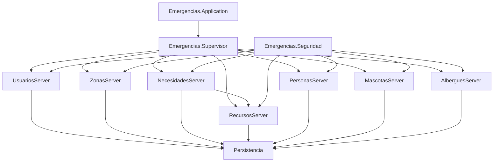
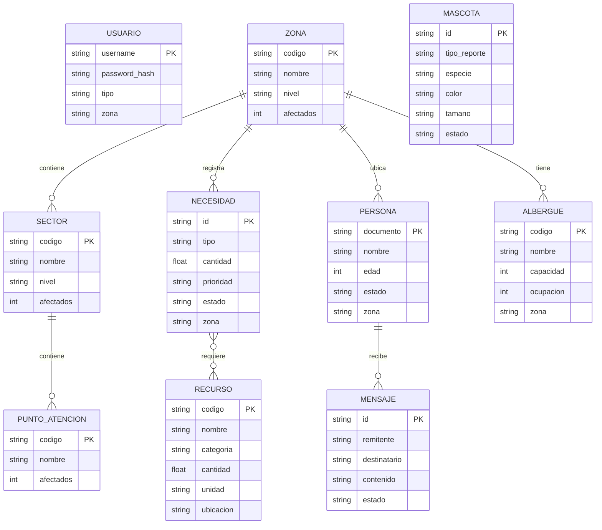
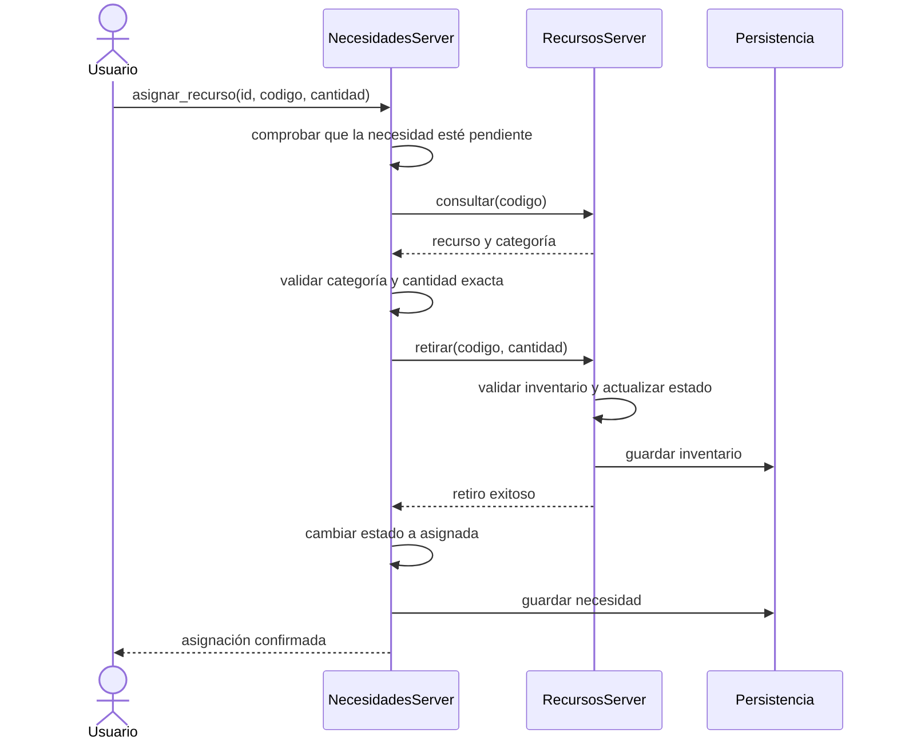
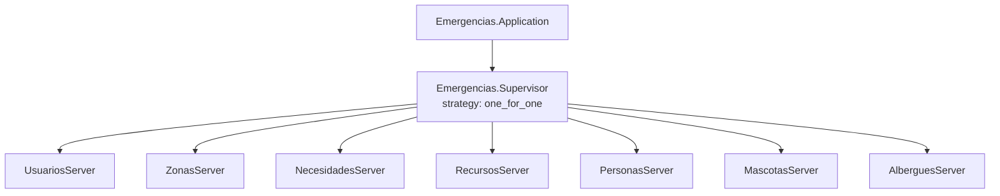

# Diagramas iniciales del sistema

Estos diagramas describen la arquitectura implementada en `lib/`. Deben revisarse si el equipo modifica los módulos.

## Arquitectura de módulos

## Modelo de datos conceptual

## Secuencia de asignación de recursos

## Árbol OTP

